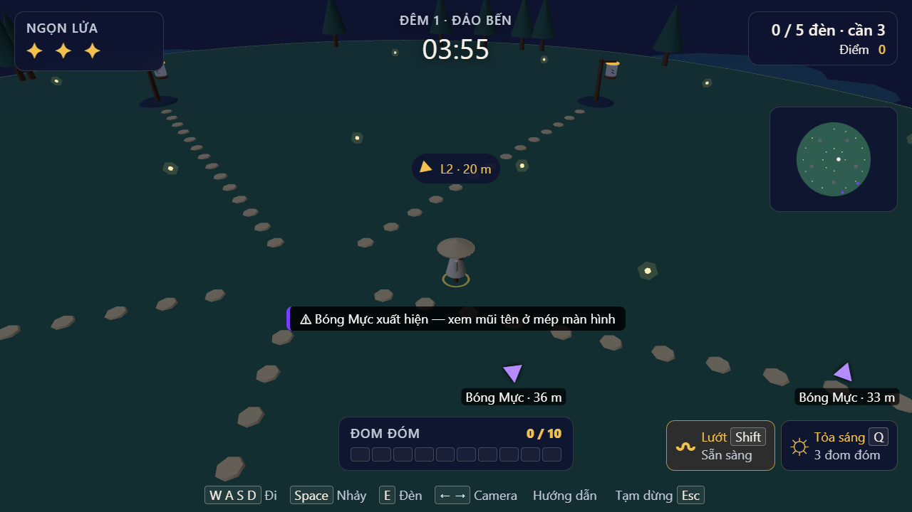

# Đảo Đèn Lồng · v1.0.0

> 🎬 **Video demo:** [demo.mp4](docs/demo/demo.mp4) — 3 phút 41,5 giây, chơi thật các Đêm, chạy kiểm chứng và benchmark.
> 📦 **Bản chạy được:** `dao-den-long-v1.0.0.zip` trong cùng Release. Chỉ cần Node.js 20+, không cần `npm install`.

Game 3D góc nhìn thứ ba chạy trên trình duyệt. Bạn cùng Mây, người giữ đèn đội nón lá, gom đom đóm, thắp và châm dầu cho đèn lồng, đẩy lùi Bóng Mực và giữ đủ đèn sáng tới bình minh qua ba hòn đảo. **Phase 4 · Ticket-04 · Test Contract v1.3.**



Các phase trước giữ ở tag `phase-1`, `phase-2`, `phase-3`. Hồ sơ Phase 4: [spec và kiểm chứng](docs/notes/phase-4.md), [checklist bàn giao](docs/submission-phase-4.md), [retro](docs/notes/retro.md), [CHANGELOG](CHANGELOG.md). Đề lab gốc: [LAB.md](LAB.md).

## Yêu cầu hệ thống

| | Tối thiểu |
|---|---|
| Hệ điều hành | Windows 10/11, macOS 12+, Linux x64 |
| Node.js | 20 trở lên (đã thử 20.17) |
| Trình duyệt | Edge/Chrome/Firefox mới, có WebGL 2 và tăng tốc phần cứng |
| Phần cứng | GPU tích hợp đời 2020+, RAM 4 GB. Benchmark tham khảo ở bên dưới |
| Benchmark/QA | Edge (Windows) hoặc Chrome. Đặt `BROWSER_PATH` nếu dùng Chromium khác |

## Cài đặt và chạy: 3 lệnh

```bash
npm ci
npm run build
npm start
```

Mở **http://127.0.0.1:4173**. `npm start` chạy `node scripts/serve.mjs` (đây cũng là `run_cmd` trong contract). Server nhỏ này phục vụ web tĩnh trong `dist/` và lưu bảng xếp hạng ra đĩa. Three.js đã được đóng gói sẵn, không dùng CDN.

Từ bản Release: giải nén `dao-den-long-v1.0.0.zip`, rồi chạy `node scripts/serve.mjs` (hoặc `start.cmd` / `sh start.sh`).

## Điều khiển (đổi được trong Cài đặt)

Menu có **Chọn level** để bắt đầu trực tiếp ở Đêm 1 (Đảo Bến), Đêm 2 (Đảo Cau) hoặc Đêm 3 (Đảo Chuông), rồi tiếp tục tới Đêm 3. Mỗi lượt chọn đặt lại điểm; chỉ các Đêm thực sự thắng trong lượt mới được tính điểm và bảng xếp hạng. **Bắt đầu hành trình** vẫn bắt đầu từ Đêm 1.

| Phím mặc định | Hành động |
|---|---|
| W A S D | Di chuyển theo hướng camera |
| Space | Nhảy |
| Shift | Lướt |
| E | Nạp, thắp lại hoặc châm dầu cho đèn gần nhất |
| Q | Tỏa sáng (tốn 3 đom đóm, làm choáng Bóng Mực) |
| Esc | Tạm dừng / tiếp tục |
| ← / → hoặc kéo chuột | Xoay camera (giữ cố định) |

**Cài đặt** (mở từ menu hoặc khi tạm dừng) lưu trong trình duyệt:

- **Đổi phím** cho cả 9 hành động. Nếu phím đã được dùng cho hành động khác (hoặc là phím xoay camera), game báo “Trùng phím …” và không gán. Có nút **Khôi phục mặc định**.
- **Giảm chuyển động**: tắt rung camera và chớp đỏ khi trúng đòn. Đồng hồ không nhấp nháy. Đèn dầu yếu không nhấp nháy mà hiện ⚠. Mặc định theo `prefers-reduced-motion` của hệ điều hành.
- **Chữ lớn ×1,25**. Ở 1280×720, mọi chữ UI tối thiểu 18 px (browser QA đo từng text node).
- **Bảng màu dễ phân biệt** (từ Phase 3), âm lượng, độ nhạy chuột.

**Phụ đề và chỉ báo hình ảnh:** Bóng Mực xuất hiện (kèm mũi tên chỉ hướng ở mép màn hình trong 6 giây), gió sắp thổi, 10 giây cuối (đồng hồ có khung đỏ) và đèn có dầu dưới 30 (phụ đề cùng danh sách “⚠ Dầu yếu” trên HUD).

## Luật chơi (giữ nguyên v1.2)

| Đêm | Thời gian | Đèn cần sáng ở tick cuối |
|---|---:|---:|
| 1 · Đảo Bến | 240 s | 3/5 |
| 2 · Đảo Cau | 270 s | 4/6 |
| 3 · Đảo Chuông | 300 s | 5/7 |

Đèn có 100 dầu và hao 1/s. Mỗi đom đóm châm 10 dầu. Thắp lần đầu cần 10 đom đóm, thắp lại cần 5. Đèn dưới 30 dầu mất vùng an toàn 6 m, và Bóng Mực đến hút thêm 5 dầu/s. Sức chứa 10 + 2 cho mỗi lần thắp thành công, tối đa 20. Hết Ngọn Lửa luôn thua trước. Không thắng sớm khi đã thắp hết đèn. Chi tiết luật và điểm: [phase-3.md](docs/notes/phase-3.md), [ADR-003](docs/decisions/ADR-003-lantern-fuel-and-dawn.md).

## Bảng xếp hạng cục bộ

- Sau màn **Bình Minh** (thắng Đêm 3), hoặc sau khi **thua** ở bất kỳ Đêm nào, game hiện ô nhập tên để lưu điểm.
- Tên gồm 3–12 ký tự `[A-Za-z0-9_]`. Có hỗ trợ thêm chữ tiếng Việt có dấu (chuẩn hóa NFC), ví dụ `Bình_Minh`.
- Mỗi mục lưu `name`, `score` (tổng điểm các Đêm đã thắng), `nights_won` (0–3), `achieved_at` (ISO 8601 có múi giờ, do server ghi) và `seed`. Giữ top 10, xếp theo điểm giảm dần; bằng điểm thì ai đạt trước đứng trên.
- Lưu trên đĩa tại `%LOCALAPPDATA%\DaoDenLong\leaderboard.json` (Windows), hoặc `$XDG_DATA_HOME/DaoDenLong/` hay `~/.local/share/DaoDenLong/`. Đổi thư mục bằng `LANTERN_DATA_DIR`. Dữ liệu vẫn còn sau khi tắt và mở lại game.
- Menu chính có nút **Bảng xếp hạng**.
- Xuất ra file:

```bash
node scripts/serve.mjs --export-leaderboard out.json     # → {"entries":[...]} đúng thứ tự
```

## Headless (Test Contract)

```bash
node src/headless.mjs --seed 12 --night 2 --ticks 3600 --out night2.jsonl
node src/headless.mjs --seed 12 --night 1 --scenario tests/scenarios/phase-3/refuel.json --inputs tests/scenarios/phase-3/interact.inputs.json --ticks 60 --out refuel.jsonl
```

Định dạng JSONL, mã thoát (scenario/inputs lỗi → 2) và schema giữ nguyên như v1.0–v1.2. Contract: [game.contract.json](game.contract.json) (`contract_version` 1.3, có thêm `bench_cmd` và `soak_cmd`).

## Benchmark

```bash
node scripts/bench.mjs --seed 42 --duration 30 --out bench.json      # = npm run bench
```

- Mở cửa sổ Edge/Chrome thật 1280×720 (không toàn màn hình), dùng chung renderer với game.
- Cảnh Đêm 1 với đủ ánh sáng và hiệu ứng: đúng 200 Bóng Mực ở trạng thái wander, rải đều trên đảo theo seed, 100 đom đóm, L1–L3 sáng với fuel 100, Mây đứng yên ở (0,0,0).
- Tắt sinh thực thể, sát thương, nhặt đồ, hao dầu và điều kiện kết thúc Đêm. Bóng Mực vẫn đi theo luật wander bình thường.
- Camera bay vòng tròn bán kính 30 m, ở Y = 15, luôn nhìn vào (0,0,0), xuất phát ở (30,15,0), quay ngược chiều kim đồng hồ khi nhìn từ trên xuống, 15 s một vòng.
- 3 s khởi động, đo đúng `--duration` giây rồi thoát mã 0. Tham số sai thì thoát mã 2.
- **vsync:** tắt bằng cờ Chromium `--disable-gpu-vsync --disable-frame-rate-limit`. Đã kiểm tra: trang WebGL đơn giản chạy 165 fps (màn 165 Hz) khi bật vsync và hơn 1.500 fps khi tắt. Muốn đo với vsync bật thì đặt `BENCH_VSYNC=on`, khi đó `vsync_off` ghi `false`.
- **load_ms** tính từ lúc tiến trình `node` bắt đầu (`performance.timeOrigin`) tới khung hình đầu tiên của cảnh bench, nên đã gồm cả thời gian khởi động server và trình duyệt.
- **peak_mem_mb** là tổng RSS (working set trên Windows) của toàn bộ cây tiến trình trình duyệt (browser, GPU, renderer…), lấy mẫu 2 s một lần trong lúc đo. Trang chia sẻ giữa các tiến trình có thể bị cộng trùng, nên đây là cận trên. Đặt `BENCH_MEMORY=off` thì ghi `null`.
- `avg_fps`, `p1_low_fps`, `frame_ms_p95` tính đúng công thức Ticket-04 trong [src/core/metrics.mjs](src/core/metrics.mjs) (có unit test).

Kết quả tự đo (chỉ để tham khảo, máy chấm sẽ đo lại) nằm trong [bench.json](bench.json): Ryzen 7 6800H + Radeon 680M, Windows 11, Edge 157, chế độ nguồn mặc định của laptop. Số đo dao động khoảng ±30% giữa các lần chạy do nhiệt độ và chế độ nguồn của laptop.

## Soak test

```bash
node --expose-gc --max-semi-space-size=1 --no-opt scripts/soak.mjs --seed 7 --nights 10 --out soak.json   # = npm run soak
```

- 10 Đêm headless liên tiếp trong cùng một tiến trình (Đêm 1 → 2 → 3 xoay vòng). Đêm thứ i (i bắt đầu từ 0) dùng seed `7 + i`.
- Input ngẫu nhiên theo seed: cứ 30 tick chọn lại hướng đi; mỗi tick có 5% nhảy, 3% lướt, 2% tỏa sáng, 10% tương tác.
- `mem_start_mb` là RSS sau khi tải xong Đêm đầu. `mem_end_mb` là RSS sau khi reset xong Đêm cuối.
- Cờ của V8 (đã khai trong `soak_cmd` của contract), không ảnh hưởng tới logic hay output của game:
  - `--expose-gc` cho phép gọi GC ở ranh giới reset.
  - `--max-semi-space-size=1` giữ young generation nhỏ.
  - `--no-opt` tắt tầng tối ưu TurboFan.
- Vì sao cần các cờ này: khi đo không dùng cờ, heap JS gần như phẳng (3,4 → 3,7 MB qua 40 Đêm), tức là không rò rỉ. Nhưng RSS tăng khoảng 4–5 MB ngay trong Đêm đầu do bộ nhớ native của trình biên dịch JIT, sau đó gần như đứng yên (38,6 → 39,6 MB từ Đêm 10 tới Đêm 40). Với baseline chỉ khoảng 33 MB, mức khởi động một lần này đủ đẩy tỉ lệ lên 1,22–1,25 (chỉ `--expose-gc`) hoặc 1,15–1,21 (thêm semi-space). Với `--no-opt`, 6 lần đo đều nằm trong khoảng 1,09–1,11, và soak vẫn xong trong khoảng 3 giây.
- Kết quả: [soak.json](soak.json).

## Kiểm thử

```bash
npm test               # 81 unit/CLI tests (Phase 1–4)
npm run verify         # tests + build + scenario/headless + replay tất định + full-night + soak + export leaderboard
npm run test:browser   # Edge 1280×720: 3 bản đồ, UI accessibility/fuel/leaderboard, FPS
```

`npm run verify` chỉ ghi vào [docs/proof/phase-4](docs/proof/phase-4/) (kèm hash mã nguồn); bằng chứng Phase 1–3 giữ nguyên. Browser QA dùng một `LANTERN_DATA_DIR` tạm, không đụng vào bảng xếp hạng thật. Chi tiết từng kiểm tra: [verification.json](docs/proof/phase-4/verification.json), [browser-qa.json](docs/proof/phase-4/browser-qa.json).

## Cấu trúc và harness

- `src/core/`: simulation 60 Hz, map, campaign, validation, cảnh benchmark, metrics, luật leaderboard. Không có render, đồng hồ thật hay random không seed.
- `src/headless.mjs`: CLI theo contract.
- `web/`: renderer Three.js, HUD, phím, âm thanh.
- `scripts/`: server, build, bench, soak, verify, QA, đóng gói release.
- Harness AI: [AGENTS.md](AGENTS.md), các script verify/QA, [GitHub Actions](.github/workflows/verify.yml).

## Sáng tạo của tôi

Nón lá treo đèn, biển mây, lối đá, minimap, âm thanh tổng hợp bằng Web Audio, camera tránh bị che. Rung camera và chớp đỏ khi trúng đòn là hiệu ứng thuần hình ảnh, tắt được. Mọi chi tiết trang trí đều không ảnh hưởng tới headless; cảnh benchmark không thêm thực thể sáng tạo nào.

Nguồn asset và công cụ: [CREDITS.md](CREDITS.md). Giấy phép: [LICENSE](LICENSE).
